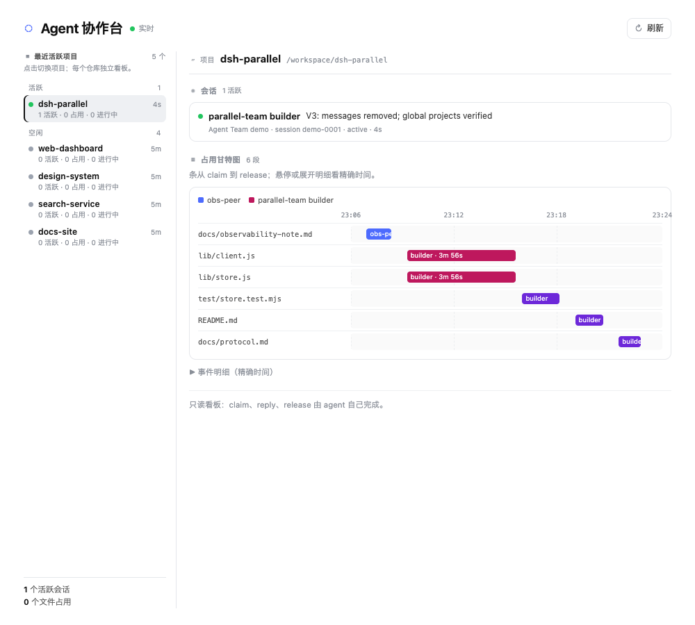

<div align="right">
  <a href="README.md"></a>
  <a href="README.en.md"></a>
</div>

# Agent Team

**dsh-parallel** · a read-only DSH board for parallel agents

<p>
  
  
  
  
  
  <a href="https://github.com/luochang212/dsh-parallel/actions/workflows/ci.yml"></a>
</p>

**Let multiple agents in one repository see each other, avoid editing the same file at the same time, and leave a reviewable occupancy timeline.**

It is not a chat tool and not a human control panel. It is a read-only coordination board:

- who is doing what (a one-line focus per session);
- which file is currently held, and by whom (a file lease);
- when it was claimed, when it was released, and by whom (a claim/release timeline).

<p align="center">
  
</p>

_UI illustration with demo data._

## ✨ What it solves

When several agents work in one repository, the hard part is usually not writing code. It is:

- not knowing what the others are doing;
- editing the same file and overwriting each other;
- being unable to say who touched which file, and when.

Agent Team does exactly three things:

| Capability        | What it does                                               |
| ----------------- | ---------------------------------------------------------- |
| **Presence**      | One line of focus per session, visible to peers            |
| **Claim / Lease** | Reserve a file before writing; live conflicts are rejected |
| **Timeline**      | Record every claim, release, and expiry as a Gantt chart   |

There is no message queue, no inbox, and no "needs reply" state. Focus is a property of the current session: it needs no answer and has no lifecycle.

## 🧠 Three concepts

### Presence: one line saying "what I am doing"

Each DSH session has a presence row in its repository:

- focus: one line about current work;
- status: active / idle / blocked / done;
- heartbeat: proof that the session is alive;
- sessionTitle: the human-readable conversation title.

Focus is inferred from the first user/subagent prompt and can be updated with team_status.

### Claim: a lease on a file

An agent takes a lease before writing:

- default **auto**: the first write/edit creates an auto claim;
- a live claim owned by another agent denies the write;
- the same agent can renew its own claim;
- auto claims are released when the agent goes idle;
- explicit claims need an explicit release, or expire after their TTL.

Claims are exact file paths. Directories and globs are not supported.

### Change: the claim/release timeline

Every claim belongs to a change:

- which session (sessionId + sessionTitle);
- what is being changed (intent);
- which files (paths);
- current state (claimed / done / expired);
- the absolute time and actor of every claim / release / expiry.

The UI renders these events as a per-file Gantt chart. A bar runs from claim to release; an active lease extends to now and is striped.

## 🖥️ UI

One read-only screen, split into a master-detail layout:

- **Project rail (left)**: full height, sticky; recent projects with status dot, active sessions, claims, active changes, and last activity. The selected project's session and file counts sit in a footer at the bottom.
- **Detail pane (right)**: project path, sessions, claim Gantt, and a collapsible exact-time event list.
- **No inputs**: no composer, no message box, no reply/release button. Project rows are navigation buttons; Refresh is the only action button.

On narrow screens the project rail becomes a horizontal scrollable list above the detail pane.

## 🚀 Quick start

### 1. Install into a DSH profile

```sh
PROFILE="$HOME/.dsh/profiles/desktop"
mkdir -p "$PROFILE/node_modules"
ln -sfn /absolute/path/to/dsh-parallel "$PROFILE/node_modules/dsh-parallel"
```

### 2. Add the plugin config

Append this to $PROFILE/cordis.patch.yml:

```yaml
- insert:
    - id: dsh-parallel
      name: dsh-parallel
      config:
        heartbeatMs: 15000
        ttlMs: 60000
        claimPolicy: auto
        autoClaimTtlMs: 600000
        releaseAutoOnIdle: true
```

Leave root empty. Each agent resolves its repository from its session cwd. Setting root forces every session onto one board and is only useful for single-repository debugging.

### 3. Restart and open

Restart the DSH host, refresh the page, and open **Agents** in the left sidebar.

Every project tracked by the plugin on this DSH appears in the project rail. A project never opened with the plugin is not discovered automatically.

## 🧰 Tools and CLI

The runtime exposes exactly three tools:

| Tool            | Purpose                                                                          |
| --------------- | -------------------------------------------------------------------------------- |
| **team_status** | Update focus, status, plan, and files                                            |
| **team_roster** | Read active agents, claims, and active/recent changes for the current repository |
| **team_claim**  | Claim, release, or list paths; reason is the change intent or release summary    |

The CLI shares the same files:

```sh
node bin/dsh-parallel.mjs join    --name reviewer --focus "reviewing the guard"
node bin/dsh-parallel.mjs status  --id <id> --focus "reading the claim timeline"
node bin/dsh-parallel.mjs claim   --id <id> --paths lib/store.js --intent "timeline fix"
node bin/dsh-parallel.mjs release --id <id> --paths lib/store.js --summary "done"
node bin/dsh-parallel.mjs claims
node bin/dsh-parallel.mjs changes
node bin/dsh-parallel.mjs list
node bin/dsh-parallel.mjs leave --id <id>
```

## 📦 Data layout

Each repository has its own board:

```text
<repo>/.dsh/parallel/
  config.json
  agents/<agent-id>.json
  claims/<sha1(repo-relative-path)>.json
  changes/<change-id>.json
```

The global index only tracks recent projects:

```text
~/.dsh/parallel/projects.json
```

It stores root / name / lastSeenAt only. Presence, claims, and timelines always live in each repository's own .dsh/parallel. Claims are never merged across projects, and there is no cross-project lock.

## 🧭 Decisions

Key choices are recorded with [adr-kit](https://github.com/luochang212/adr-kit) under [adr/](adr/README.md). There are seven implemented decisions:

- **ADR 1**: one board per repository; the global project index only discovers and summarizes, and never introduces a cross-project lock.
- **ADR 2**: no messages, inbox, or question queue; focus is a session property; the panel is read-only.
- **ADR 3**: record occupancy as a claim/release timeline and render it as a per-file Gantt.
- **ADR 4**: the project list is navigation, not content; use a full-height project rail instead of cards above the Gantt.
- **ADR 5**: one read-only screen and three concepts; no tabs, cards, feeds, setup screen, or composer.
- **ADR 6**: every change records conversation identity, intent, paths, and release state.
- **ADR 7**: short-lived auto leases for writes; explicit leases for planned work, released on idle or after TTL.

Run **adrkit list** at task start and read the relevant implemented records. Use **adrkit relevant <path>** when a task targets specific files. Add or change decisions with **adrkit record** or **adrkit propose**, and run **adrkit validate --all** before finishing.

## ⚙️ Configuration

| Key               | Default         | Meaning                                                           |
| ----------------- | --------------- | ----------------------------------------------------------------- |
| root              | empty           | Optional forced repository. Empty means each session uses its cwd |
| registryDir       | ~/.dsh/parallel | Directory for the global project index                            |
| heartbeatMs       | 20000           | Presence renewal interval                                         |
| ttlMs             | 90000           | Presence TTL                                                      |
| claimPolicy       | auto            | off / advisory / require / auto                                   |
| autoClaimTtlMs    | 600000          | Auto-claim TTL                                                    |
| releaseAutoOnIdle | true            | Release auto claims when the turn ends                            |

claimPolicy values:

- **auto**: auto-claim on write/edit, deny conflicts;
- **require**: deny a write with no claim;
- **advisory**: warn but do not block;
- **off**: disable the write guard.

The write guard covers write/edit only. Shell redirection through bash or run_code is outside it.

## 🧪 Development and testing

There is no build step. The browser bundle is loaded directly by the DSH module loader.

```sh
node --test test/store.test.mjs   # store / timeline / registry / concurrency / CLI
node test/host-smoke.mjs          # tools / write guard / /projects / /claim / /release
node test/ui-flow.cjs             # read-only UI + screenshots
```

The UI test requires the desktop DSH host, Playwright, and the local desktop auth cookie. It asserts:

- CONTROLS 0
- HAS_PROJECTS true
- HAS_TIMELINE true
- HAS_SESSION true
- no console errors

Refresh the page after client changes; restart the host after host changes. Development rules are in [AGENTS.md](AGENTS.md); the file format is in [docs/protocol.md](docs/protocol.md).

## ⚠️ Limitations

- No cross-project lock; unrelated repositories can work in parallel.
- The project list comes from roots tracked by the host plus the global registry; a never-opened project does not appear.
- Claims are exact paths, not directories or globs.
- Auto claims release on idle; explicit claims need release or TTL expiry.
- One active change per agent; release the old change before starting a new one.
- The Gantt shows claim/release time, not git-diff or commit-level proof.
- Different git worktrees are different boards.
- Timeline history is kept for 7 days by default.

## 📜 License

[MIT](LICENSE)
